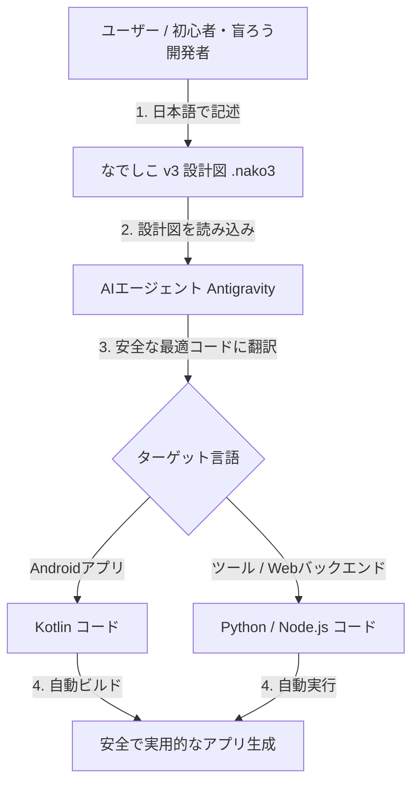

# なでしこ v3 × AIエージェント アプリ開発構想

## 概要

本構想は、実績のある日本語プログラミング言語**「なでしこ v3 (`.nako3`)」**をアプリの設計図・ロジック記述言語として採用し、**AIエージェント（Antigravity等）**がそれを解釈・翻訳して、**Kotlin**（Androidアプリ等）や **Python** などの実用的で安全なプロダクションコードを自動生成・開発することを目指します。

従来の英語ベースのプログラミング記号や複雑な文法によるハードルを極限まで下げ、プログラミング初心者やアクセシビリティ利用者（スクリーンリーダーや点字ディスプレイ使用者など）が、安心して高品質なアプリを安全に開発できる環境を提供します。

---

## 主な特徴とメリット

### 1. なでしこ v3 (`.nako3`) による直感的な設計図記述

- **圧倒的なアクセシビリティ**: PC-TalkerやNVDAなどのスクリーンリーダー、ブレイルセンス等の点字端末において、日本語テキストとして極めてスムーズかつ正確に読み上げられます。
- **ストレスフリーなロジック作成**: 複雑な英語の記号やインデントエラーに怯えることなく、日本語で「何をしたいか」のロジックそのものに集中できます。

```nako3
# なでしこ v3 によるプログラム設計図のイメージ (.nako3)
【アプリ名】「簡易読み上げメモ」

ユーザーが「保存ボタン」を押した時：
    入力テキストは メモ入力欄のテキスト。
    もし 入力テキストが空ならば：
        「メモが入力されていません」と 音声出力する。
    そうでなければ：
        入力テキストを データベースに保存する。
        「メモを保存しました」と 音声出力する。
```

### 2. AIエージェント（Antigravity等）による安全なプロダクションコード翻訳

- **意図の正確な汲み取り**: AIエージェントが `.nako3` ファイルに書かれた日本語ロジックを読み取り、ターゲット環境に最適なアーキテクチャでコードを生成します。
- **最新かつ安全なコード**: Android向けには最新スタックの **Kotlin**（Nullセーフ、AccessibilityServiceガイドライン準拠）、バックエンドやツール向けには **Python** などに自動翻訳します。
- **自動エラーチェックと堅牢性**: AIが翻訳時に各種セキュリティ・Nullポインタチェック・アクセシビリティ対応を自動適用します。

---

## 開発・翻訳パイプライン（システムフロー）



---

## プロジェクトフェーズ

### Phase 1: 基本設計とプロトタイプ検証

- `.nako3` の設計図記法ガイドラインの整理
- Antigravity等のAIエージェント用プロンプト・翻訳パイプラインの構築
- `.nako3` から Kotlin / Python への基本翻訳プロトタイプの動作検証

### Phase 2: アクセシビリティ・ビルド連携

- スクリーンリーダー（PC-Talker / NVDA）および点字端末での操作性・可読性の検証
- 自動ビルドスクリプト（`./tools` 内）との連携によるスムーズなデプロイ環境構築
- 実用サンプルアプリ（アクセシビリティ支援ツール等）の作成

### Phase 3: 機能拡張とコミュニティ展開

- エラー発生時の日本語による分かりやすいフィードバック機能
- 高度なUI/ロジック表現に対応する `.nako3` テンプレートの拡充
- ドキュメント・チュートリアルの公開によるプログラミングの民主化

---

## 将来展望

- **「日本語で書いて、AIがプロコード化する」新しい開発スタイルの確立**
- 初心者や障害を持つ開発者が、技術的ハードルを感じずにアイデアを即座にアプリ化できる社会の実現
- 安全かつ高品質なコード生成によるアクセシブルなソフトウェアエコシステムの拡大
